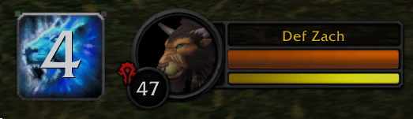
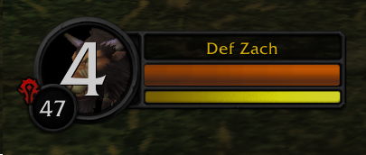
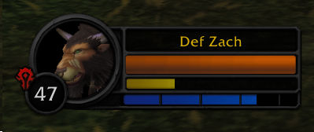

# Shifting Power Count

Shows how many casts of Shifting Power (spell 1322605, WoW Forever Feral) your current mana pays for, as one number that stays correct in combat.

## Screenshots

| Icon and number | Number only | Bar |
| :---: | :---: | :---: |
|  |  |  |

## Install

Copy or link this folder (`ShiftingPowerCount`) into the Forever `Interface\AddOns` folder. It needs only the `.toc` and `.lua`.

## Options

Options > AddOns > Shifting Power Count, or `/spcount` (opens the panel). Every change applies live, also in combat. The page has a General section (Display, Show only in Cat Form, Personal Resource Display ticks and their style, Lock and Reset position) and a Style section that shows only the rows of the selected Display; each Display keeps its own style.

- Display: Icon and number, Number only, or Bar (Placement, in Style, puts the bar on the player frame or floating). (No "icon only": the number is the point of the addon.)
- Bar on player frame: a mana bar as a fourth row under the default player frame's bars, in a StatusBar parented to PlayerFrame one strata below it (so the portrait ring tucks over its left end). It uses the unit frame's own bar atlases, mask and extended frame art, with a tick at every Shifting Power cost and the count on the bar. Size does not apply to it; the number size is capped at 14 there, and the digits sit on their own overlay frame so they are never clipped by the bar. Ticks are plain 2px lines (white, black or yellow), or Frame. Bar style: Normal; Match player frame (default when the DarkMode addon is loaded) copies the vertex colour PlayerFrame's frame art carries (read from AlternatePowerFrameTexture or FrameTexture, kept current by a hook) onto our art copy and well, the fill keeps its colour; Dark is a fixed near-black well, a dimmer fill and a darker art copy. PlayerFrame's own textures are never written. If PlayerFrame is hidden or replaced by another unit-frame addon, the floating bar is used and a chat line says so once. A mode change in combat waits until combat ends. Bar options: placement, colour, style, cast ticks, tick colour (Frame only On player frame), count text.
- Bar, Placement Floating: a separate bar of your own (a StatusBar on UIParent) that you drag when unlocked; Reset position puts it back below the screen centre. Width 50-400, height 4-40, texture (any LibSharedMedia statusbar, so ElvUI's and other packs' textures), background opacity, a 1px border on or off, and the count position (center, left, right, above, below). Fill colour follows Bar colour; cast ticks and the count work as on the player frame (Frame tick colour shows as white; switching to Floating changes a Frame tick colour to White). It is also what Bar mode shows when the player frame is unavailable.
- Personal Resource Display: cast ticks (on by default, every mode): the same ticks on the Personal Resource Display's mana row, which Forever shows in Cat and Bear Form. They live on the addon's own frame on that row, so they hide, scale and resize with it (Edit Mode width and height). Their own tick style: Border (default, a slice of that bar's frame art), Pip (Blizzard's Cooldown Manager marker), or white, black or yellow.
- Show only in Cat Form (on by default, every mode): hides the display outside Cat Form (GetShapeshiftFormID == 1).
- Size: scales the whole frame (icon and number together), 0.5 to 3.0. The position is kept.
- Icon opacity, Lock position, Reset position button.
- Number size, font (any LibSharedMedia font: Friz Quadrata, Arial Narrow, Morpheus, Skurri and what other addons register), outline (none, outline, thick), colour (white, yellow, green, cyan, orange), position (center, below, above the icon). All counts share these.
- Show 0 in red (on by default; off uses the number colour).
- Each slider (Size, Icon opacity, Number size, Width, Height, Background opacity) has a number box beside it. Type a value and press Enter or click away: it is clamped to the slider range and rounded to its step; invalid text reverts (Escape reverts too). Box, slider and `/spcount` commands stay in step.

## Commands

- `/spcount` prints cost, max mana, casts at full and the main options, and opens the panel
- `/spcount size <0.5-3>`, `fontsize <8-72>`, `alpha <0-1>`
- `/spcount mode icon|text|bar`, `placement player|floating`, `width <50-400>`, `height <4-40>`, `texture <LibSharedMedia name>`, `bgalpha <0-1>`, `border on|off`. A style command for a mode other than the current Display prints which mode it changed. Style commands below act on the Display currently selected; bar-only ones (`barcolor`, `tickcolor`, `dark`, `ticks`, `bartext`, `placement`) always write the bar style.
- `/spcount barcolor mana|energy|rage|focus|runic`, `tickcolor white|black|yellow`, `dark normal|match|dark` (`on|off` = dark|normal), `catonly on|off`, `ticks on|off`, `bartext on|off`, `prdticks on|off`, `prdtickstyle border|pip|white|black|yellow`
- `/spcount font <LibSharedMedia name>` (for example `arial narrow`), `outline none|outline|thick`, `color white|yellow|green|cyan|orange`, `pos center|below|above` (Icon and number) or `pos center|left|right|above|below` (floating bar)
- `/spcount zero on|off`
- `/spcount lock` / `unlock` stops or allows dragging the frame
- `/spcount reset` puts the frame (or the floating bar) the current Display shows back at its default spot

Settings are saved in `ShiftingPowerCountDB`; the panel and the commands write the same fields.

## How it works with secret mana

Mana is secret in combat, so the addon never does arithmetic on it. It keeps one label per count, each with a step curve over mana percent that is 1 only inside its band, and `UnitPowerPercent(..., curve)` hands the secret result straight to `SetAlpha`. Cost and max mana are read out of combat and the bands are rebuilt. Option changes only touch plain values on the addon's own frame (scale, alpha, font, anchors).

## Credits

Bundled libraries (in `Libs/`, each with its licence file or note): LibStub and CallbackHandler-1.0 (Ace3 Development Team, BSD, `LICENSE.txt`) and LibSharedMedia-3.0 by Elkano (LGPL v2.1, text in `LICENSE-LGPL-2.1.txt`, see `LICENSE-NOTE.md`), taken from Hekili Forever's copies.

## Development

`make bootstrap` once (Lua 5.1, busted and luacheck into `.lua/`), then `make check` before a push: luacheck, syntax, the busted specs (fake client in `spec/fake.lua`) and the CurseForge upload tests. `make package-check` builds the zip locally with the pinned BigWigs packager and checks it.

## Release (CurseForge project 1812424, `shifting-power-count`)

1. Move the `## Unreleased` notes in `CHANGELOG.md` under the new version and commit.
2. Push a tag `vX.Y.Z` (or `vX.Y.Z-rc.N` for a beta). The release workflow runs the checks, builds the zip and attaches it to a **draft** GitHub release.
3. Edit the draft's notes (they become the CurseForge changelog) and publish it. The publish workflow uploads the zip to CurseForge for WoW Forever 1.60.1; a pre-release uploads as a beta. It needs the repository secret `CF_API_KEY`.
